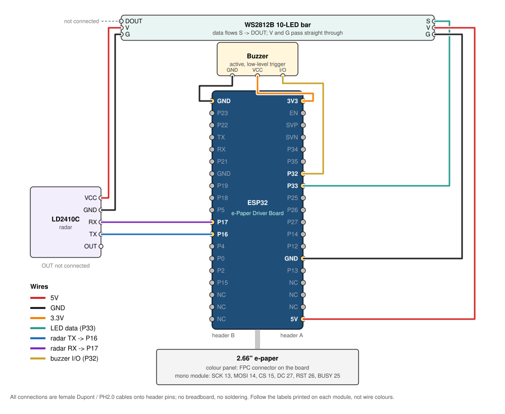
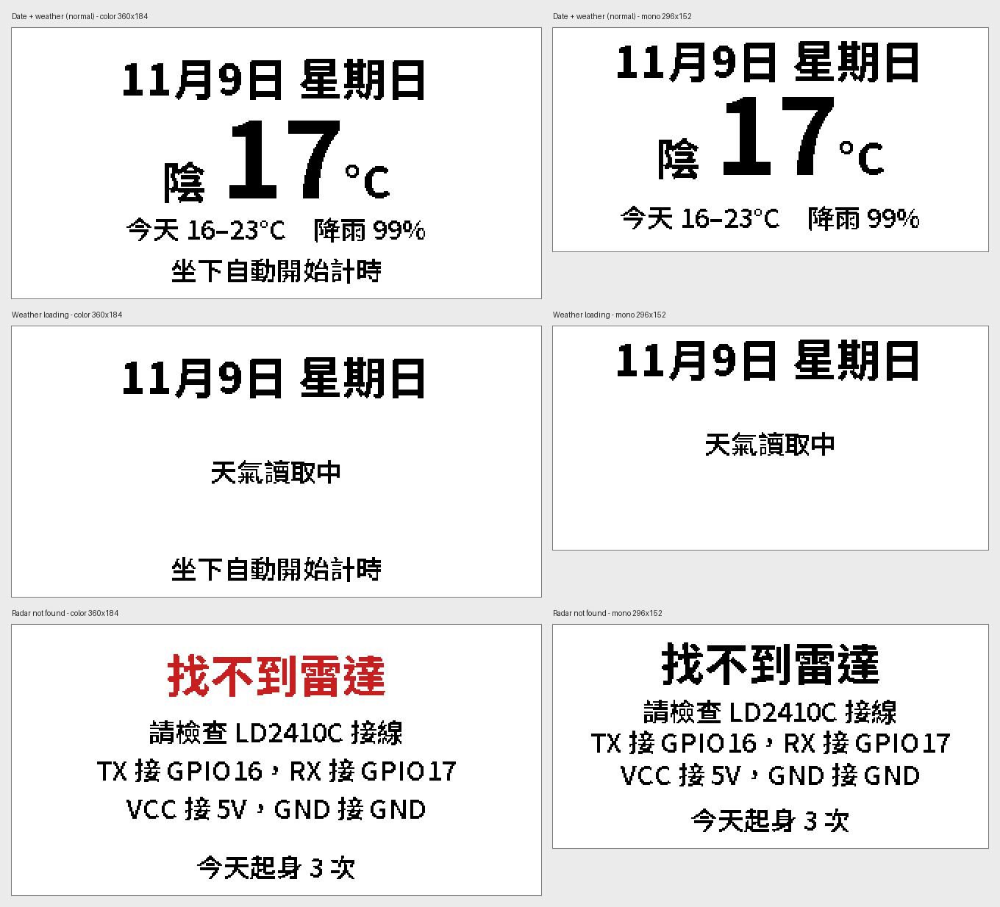

# Seat Timer

Reminds you to stand up after 30 minutes of continuous sitting. A mmWave radar
on the desk detects whether you are in the chair, so the timer starts and stops
by itself regardless of whether you use the computer, the phone, or both.

## Behaviour

The e-paper never changes while you sit. One LED at the input end of the bar
shows what the radar currently thinks: steady green = seated, steady blue =
away but the break is not counted yet, dark = nobody. The whole bar lights only
when it is time to stand (red) or when a break has been counted (green).

| Situation | What happens |
|---|---|
| Sit down for 5 s | Session starts, buzzer beeps once, first LED steady green |
| Stand up (away 3 s) | Buzzer beeps twice, first LED steady blue; any reminder still sounding stops |
| Back within 1 min | Buzzer beeps once, session continues |
| Away 1 min | Break counted, timer resets; buzzer beeps 3 times and LEDs blink green 3 times, then dark |
| 30 min seated | LEDs blink red, buzzer beeps 3 times; repeats every 90 s with one more beep each time (max 8) |
| Away 4 h+ | Break counter resets (treated as a new day) |
| Radar unplugged | LEDs blink purple slowly, e-paper "Radar not found" |

Logic lives in `src/sit_logic.h` (no Arduino deps); tests in `test/test_sit_logic.cpp`.

## Hardware

| Part | Notes |
|---|---|
| Waveshare e-Paper ESP32 Driver Board | ESP32-WROOM-32E, FPC connector for the panel |
| Waveshare 2.66inch e-Paper, either panel | **4-colour (G)**: 360x184, black/white/yellow/red, `GxEPD2_266c_GDEY0266F51H`, tested. **Black/white module**: 296x152, `GxEPD2_266_BN`, builds but not yet tested on hardware. Selected in `src/panel.h` by build env |
| HLK-LD2410C | Must be the **C** variant (2.54 mm header) |
| Active buzzer module, low-level trigger | 3 pins: VCC / GND / I/O |
| WS2812B 10-LED bar with PH2.0 connectors | Plus a PH2.0 3P to Dupont female cable |
| Female-female Dupont wires | No soldering, no breadboard needed |
| Second PH2.0 3P to Dupont cable | Feeds 5 V to the radar through the LED bar |

## Wiring



The diagram is generated: edit `WIRES` in `tools/draw_wiring.py`, then run
`python3 tools/draw_wiring.py > docs/wiring.svg`.

E-paper pins are SCK 13, DIN 14, CS 15, DC 27, RST 26, BUSY 25. The 4-colour panel
plugs into the board's FPC connector, which is wired to those pins. The black/white
module comes with an 8-pin cable; connect it to the same GPIOs on the headers.
Its VCC needs a supply pin, but 5V and 3V3 are both taken, so the power wiring for
the mono module is still to be worked out when it arrives.

The board has one 5V pin, one 3V3 pin and three GND pins (right header, and
positions 1 and 7 of the left header). The LED bar passes 5V/GND from its
input end to its output end, so the radar takes power from the bar's output
end and no breadboard is needed.

| From | To |
|---|---|
| LED bar `S` end: `S` | GPIO 33 |
| LED bar `S` end: `V` | 5V |
| LED bar `S` end: `G` | GND (right header) |
| LED bar `DOUT` end: `V` | LD2410C VCC |
| LED bar `DOUT` end: `G` | LD2410C GND |
| LED bar `DOUT` end: `DOUT` | not connected (tape it) |
| LD2410C TX | GPIO 16 |
| LD2410C RX | GPIO 17 |
| Buzzer VCC | 3V3 |
| Buzzer GND | GND (left header, position 1) |
| Buzzer I/O | GPIO 32 |

The LED bar's data input is the `S|V|G` end; the `DOUT|V|G` end only passes
data on. Follow the printed labels, not wire colours.

Put the radar facing your torso, about 40–80 cm away. Measured on 2026-11-14:
seated 30–86 cm, empty chair ~148 cm, so `SEATED_MAX_CM = 100`.

The radar reports only distance and whether something moves, not height, so it
cannot tell sitting from standing on the spot. "Stood up" here means "left the
seat": standing beside the desk still counts as seated.

## Quick start

1. Install [PlatformIO](https://platformio.org/install/cli) (`pip install platformio`).
2. Wire the parts as above. Unplug USB while wiring.
3. Create your local settings file and fill in at least the Wi-Fi name and password:
   `cp src/secrets.example.h src/secrets.h`
4. Flash a bench-test build first, so you do not have to sit for 30 minutes:
   `pio run -e color-demo -t upload` (or `mono-demo` for the black/white panel).
5. Watch the serial log with `pio device monitor`. Sit down and stand up, and check
   `dist=` while seated and with the chair empty (see `SEATED_MAX_CM` below).
6. Flash the normal build: `pio run -e color -t upload` (or `mono`).

## Configuration

Everything you are likely to change. Settings in `src/secrets.h` stay on your
computer (the file is in `.gitignore`); the rest are constants in the source.

| What | Where | Default | Notes |
|---|---|---|---|
| Wi-Fi name / password | `src/secrets.h`: `WIFI_SSID`, `WIFI_PASSWORD` | empty (offline) | 2.4 GHz only. Without Wi-Fi the timer works; date and weather do not |
| Weather location | `src/secrets.h`: `WEATHER_LAT`, `WEATHER_LON` | central Taipei | Decimal degrees as strings, e.g. `"25.0330"` |
| Time zone | `src/secrets.h`: `TIME_ZONE` | `"CST-8"` (UTC+8) | POSIX TZ string, e.g. `"JST-9"` |
| NTP servers | `src/secrets.h`: `NTP_SERVER_1` .. `_3` | `time.stdtime.gov.tw`, `pool.ntp.org`, `time.google.com` | |
| Panel | build env: `color*` or `mono*` | `color` | See `platformio.ini`, `src/panel.h` |
| Sitting limit before reminding | `src/sit_logic.h`: `sitLimitMs` | 30 min | |
| Away time that counts as a break | `src/sit_logic.h`: `breakMs` | 1 min | |
| Presence needed to count as "sat down" | `src/sit_logic.h`: `sitConfirmMs` | 5 s | Stops a passer-by from starting the timer |
| Absence needed to count as "stood up" | `src/sit_logic.h`: `awayShowMs` | 3 s | Raise it if you hear stand-up beeps while still seated |
| Reminder repeat interval | `src/sit_logic.h`: `remindEveryMs` | 90 s | |
| Seated distance | `src/main.cpp`: `SEATED_MAX_CM` | 100 cm | Set between your seated `dist=` and the empty-chair `dist=` |
| Buzzer polarity | `src/main.cpp`: `BUZZER_ACTIVE_LOW` | `true` | Flip if the buzzer sounds constantly at boot |
| LED count / brightness | `src/main.cpp`: `LED_COUNT`, `LED_BRIGHTNESS` | 10, 60 of 255 | |
| Pins | `src/main.cpp`: `PIN_*` | see Wiring | |
| Nightly e-paper wipe | `src/main.cpp`: `CLEAR_HOUR` | 3 (03:00) | |

The `*-demo` envs override the times in `makeConfig()` in `src/main.cpp`:
60 s limit, 20 s break, 10 s repeat.

## Build, test, debug

```sh
pio run -e color -t upload        # 4-colour panel, normal
pio run -e color-demo -t upload   # 4-colour panel, bench test
pio run -e mono -t upload         # black/white panel, normal
pio run -e mono-demo -t upload    # black/white panel, bench test
pio device monitor                # serial log, 115200
```

Serial log lines:

| Line | Meaning |
|---|---|
| `[state] Sitting seated=1 dist=45cm sit=120s away=0s breaks=2 radar=ok` | Once a second: state, radar distance, session length |
| `[cue] sat down` / `[cue] stood up` | 1-beep / 2-beep cues |
| `[remind] #n` | n-th stand-up reminder of this session |
| `[break] done, breaks=n` | Away long enough; timer reset |
| `[wx] HTTP 200 (-) parse=ok rssi=-65 ...` | Weather fetch result; on failure the error text |
| `[net] wifi=up rssi=-64 dBm ip=...` | Once a minute |
| `[epd] screen=1 ... refreshed in 20979 ms` | E-paper redraw |

Serial commands for testing without the radar: `1` force seated, `0` force not seated, `a` back to radar.

Host tests (no board needed):

```sh
g++ -std=c++17 test/test_sit_logic.cpp -o /tmp/t && /tmp/t
g++ -std=c++17 -I .pio/libdeps/color/ArduinoJson/src test/test_weather.cpp -o /tmp/w && /tmp/w
g++ -std=c++17 test/preview_screens.cpp -o /tmp/p && /tmp/p /tmp   # both panel sizes
```



## Chinese text on the e-paper

Screens are drawn by `src/screen.h` using pre-rendered glyph bitmaps in
`src/zh_font.h` (only the characters actually used, ~9 KB). Font: Noto Sans TC,
SIL Open Font License.

To change on-screen text:

1. Edit the string in `src/screen.h`.
2. Add it to `TEXTS` in `tools/gen_zh_font.py`, then regenerate:
   `python3 tools/gen_zh_font.py NotoSansTC[wght].ttf`
   (download from https://github.com/google/fonts/tree/main/ofl/notosanstc).
3. Preview on the computer and check for missing glyphs:
   `g++ -std=c++17 test/preview_screens.cpp -o /tmp/p && /tmp/p /tmp`
   (writes one `.ppm` per screen).

## Network: date and weather

- Date comes from NTP (servers and time zone in Configuration). There is no clock
  on screen: the 4-colour panel cannot partial-refresh.
- Weather comes from [Open-Meteo](https://open-meteo.com/) (free, no API key) every
  30 minutes; on failure it retries every 2 minutes, and a stuck TLS handshake
  gives up after 15 s. "Today" uses the location's own time zone.

The e-paper only shows date and weather. It redraws when the date changes, when
weather first arrives, when weather changes (at most once an hour, `WX_REDRAW_MS`),
or when the radar fails / recovers. After power-up the weather appears about
3.5 minutes later, because refreshes are at least 180 s apart.

## E-paper care

- Every update is a full refresh (this panel has no partial refresh).
- Refreshes are at least 180 s apart (`EPD_MIN_GAP_MS`, Waveshare's guidance),
  and the panel hibernates after each one.
- The layout shifts by up to 2 px each hour (`burnInShift` in `src/screen.h`)
  so static lines and text do not stay on the same pixels.
- At 03:00 (`CLEAR_HOUR`) every night the panel is wiped white and redrawn.
- Before storing the panel for weeks, flash `tools/epd_clear` to leave it white.
